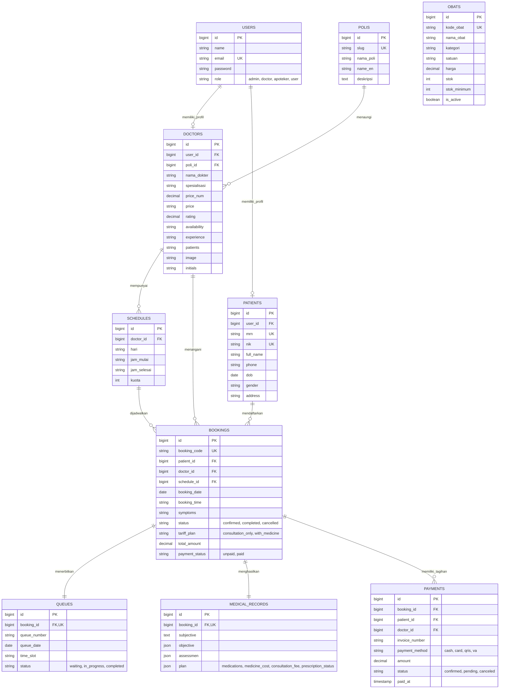

# Sistem Informasi Klinik Maristella

<p align="center">
  
</p>

<p align="center">
  <strong>Solusi Digital Terintegrasi Layanan Kesehatan Primer: Manajemen Dokter & Akun, Penjadwalan, Antrean Real-Time, Rekam Medis Elektronik SOAP, Farmasi Apoteker, dan Pembayaran Kasir</strong><br>
  Proyek Mata Kuliah Pemrograman dan Pengujian Web (PPW)<br>
  <strong>Program Studi Sarjana Sistem Informasi — Fakultas Informatika dan Teknik Elektro<br>Institut Teknologi Del</strong><br>
  Tahun Ajaran 2026/2027
</p>

---

## 👥 Disusun Oleh (Kelompok)

| NIM | Nama Mahasiswa |
| :--- | :--- |
| **12S24035** | **Josua Sianturi** |
| **12S24014** | **Arion Manurung** |
| **12S24019** | **Winda N.V. Sitorus** |
| **12S24058** | **Airene Situmorang** |

---

## 📌 Daftar Isi
1. [Tentang Sistem](#-tentang-sistem)
2. [Latar Belakang & Masalah](#-latar-belakang--masalah)
3. [Peran Pengguna & Fitur Utama (Use Case)](#-peran-pengguna--fitur-utama-use-case)
4. [Alur Bisnis Terintegrasi (End-to-End Workflow)](#-alur-bisnis-terintegrasi-end-to-end-workflow)
5. [Arsitektur & Tumpukan Teknologi (Tech Stack)](#-arsitektur--tumpukan-teknologi-tech-stack)
6. [Perancangan Basis Data (ERD & Spesifikasi Entitas)](#-perancangan-basis-data-erd--spesifikasi-entitas)
7. [Struktur Direktori Proyek](#-struktur-direktori-proyek)
8. [Daftar Rute & Endpoint (Routing)](#-daftar-rute--endpoint-routing)
9. [Panduan Instalasi & Menjalankan Aplikasi](#-panduan-instalasi--menjalankan-aplikasi)
10. [Akun Demo & Akses Cepat (Quick Login)](#-akun-demo--akses-cepat-quick-login)
11. [Pengujian Perangkat Lunak (Automated Testing)](#-pengujian-perangkat-lunak-automated-testing)

---

## 🏥 Tentang Sistem

**Klinik Maristella** adalah platform sistem informasi manajemen klinik modern berbasis web yang dirancang untuk mendigitalkan seluruh siklus pelayanan rawat jalan. Sistem ini menghubungkan 4 aktor kunci: **Pasien**, **Dokter Spesialis**, **Apoteker Farmasi**, dan **Administrator Klinik** ke dalam satu kesatuan sistem yang sinkron secara *real-time*.

Aplikasi mengusung standar estetika profesional modern dengan warna utama **Deep Royal Navy** (`#012D68`), navigasi responsif, tata letak desktop modular, serta integrasi otomatis antara penetapan diagnosis dokter, peresepan obat, peracikan farmasi, kalkulasi biaya tagihan transparan, dan pencatatan transaksi keuangan.

---

## ❗ Latar Belakang & Masalah

Pada pengelolaan klinik konvensional:
1. **Pendaftaran Manual & Penumpukan Antrean:** Pasien harus mendaftar secara fisik di loket, menimbulkan antrean panjang dan ketidakpastian jam konsultasi.
2. **Keterbatasan Akses Dokter:** Pasien tidak dapat melihat profil, keahlian, dan tarif dokter secara transparan sebelum berkonsultasi.
3. **Pencatatan Rekam Medis Terpisah:** Rekam medis berbasis kertas rentan rusak dan tidak terhubung langsung dengan bagian farmasi serta kasir.
4. **Ketidaksesuaian Tagihan Obat:** Biaya obat yang diresepkan dokter sering kali tidak sinkron dengan tagihan yang dibayarkan pasien.
5. **Pengelolaan Akun Tenaga Medis Manual:** Pendaftaran dokter dan pembuatan akun login portal medis belum terintegrasi dalam satu dasbor terpadu.

**Klinik Maristella** menghadirkan solusi menyeluruh:
- Pasien dapat memilih dokter dan membuat janji secara daring.
- Dokter memeriksa pasien dengan rekam medis digital berstandar **SOAP** (*Subjective, Objective, Assessment, Plan*) dan meresepkan obat langsung dari katalog farmasi aktif.
- Apoteker menerima resep secara *real-time*, memvalidasi (*ACC*), meracik, dan menyerahkan obat dengan pengurangan stok otomatis.
- Pasien menerima rincian tagihan transparan yang merinci jasa dokter dan daftar obat riil yang diresepkan beserta aturan pakainya.
- Administrator mengelola seluruh master data dokter, membuatkan akun login dokter secara langsung, serta memantau analitik keuangan dan laporan transaksi.

---

## 🎯 Peran Pengguna & Fitur Utama (Use Case)

### 1. Pasien (Patient / User)
- **Beranda & Pencarian Dokter:** Menjelajahi daftar dokter spesialis (Kardiologi, Neurologi, Ortopedi, dan spesialisasi lainnya) lengkap dengan foto, rating, jam ketersediaan, dan tarif.
- **Reservasi / Booking Konsultasi:** Memilih dokter, tanggal, jam praktik, dan menginput gejala keluhan secara mandiri.
- **Monitoring Status Janji Temu Real-Time:**
  - *Sebelum Periksa (Upcoming):* Kartu janji temu aktif menunggu pemanggilan dokter.
  - *Sesudah Periksa (Unpaid):* Menerima notifikasi tagihan setelah dokter menyelesaikan pemeriksaan SOAP.
  - *Lunas (Welcome State):* Kartu bertransformasi setelah pembayaran selesai tercatat.
- **Rincian Tagihan Interaktif:** Drawer rincian biaya yang menampilkan jasa konsultasi dokter dan daftar lengkap obat yang diresepkan (nama obat, jumlah, harga satuan, subtotal, dan aturan pakai).
- **Pembayaran Kasir & Kuitansi Digital:** Melakukan konfirmasi pembayaran tunai/kartu dan mencetak bukti kuitansi resmi (*Payment Success Receipt*).
- **Rekam Medis Elektronik (RME):** Memantau riwayat diagnosis dan terapi berjalan dari kunjungan-kunjungan sebelumnya.

### 2. Dokter Spesialis (Doctor)
- **Portal Kerja Dokter Eksklusif (`/doctor`):** Ruang kerja dokter yang menampilkan antrean pasien yang khusus dijadwalkan untuk dokter tersebut.
- **Pemeriksaan Klinis Berstandar SOAP:**
  - **Subjective (S):** Anamnesis keluhan utama dan durasi gejala.
  - **Objective (O):** Tanda-tanda vital (tekanan darah, detak jantung, laju nafas, suhu, SpO2, berat badan, tinggi badan) dan observasi fisik.
  - **Assessment (A):** Diagnosis primer dan sekunder sesuai kode standar medis.
  - **Plan (P):** Tindakan klinis, anjuran kontrol kembali, dan peresepan obat farmasi.
- **Katalog & Pencarian Obat Terpadu (`/doctor/obat/search`):** Memilih obat aktif dari master database lengkap dengan aturan pakai, dosis, dan kalkulasi harga otomatis.
- **Penyelesaian Antrean Pasien:** Menyimpan rekam medis yang secara otomatis meneruskan resep ke apoteker dan menerbitkan tagihan ke pasien.

### 3. Apoteker (Pharmacist)
- **Dasbor Manajemen Farmasi (`/apoteker`):** Memantau inventori obat dan antrean resep medis.
- **Pemrosesan Resep Real-Time:**
  - *Perlu Diproses:* Menerima resep baru yang diinput dokter dari lembar SOAP.
  - *Sedang Diracik (ACC Resep):* Mengonfirmasi ketersediaan obat dan memulai proses penyiapan.
  - *Selesai & Serahkan:* Menandai resep telah diserahkan ke pasien dan **mengurangi stok obat secara otomatis**.
- **Master Data Obat & Stok Opname:** Menambah obat baru, memperbarui stok masuk, dan melakukan penyesuaian fisik stok opname.

### 4. Administrator Klinik (Admin)
- **Manajemen Dokter & Akun Login (CRUD Terpadu) (`/admin/doctors`):**
  - Mendaftarkan dokter baru sekaligus membuat akun pengguna (`users`) bertipe `role: 'doctor'`.
  - Mengonfigurasi nama lengkap, poliklinik, spesialisasi, tarif sesi konsultasi, jam kerja, pengalaman, dan foto profil.
  - Mengubah profil dokter dan memperbarui email/password login dokter.
  - Menghapus data dokter dan akun login terkait secara aman.
  - Memastikan dokter yang didaftarkan **langsung tampil di beranda pasien** dan **bisa langsung login ke portal dokter**.
- **Riwayat Pembayaran & Transaksi (`/admin`):** Memantau arus kas klinik, invoice tagihan, metode bayar, dan status pembayaran.
- **Analitik Kinerja Klinik:** Grafik harian kunjungan pasien, tingkat pertumbuhan pengunjung, tindakan medis, dan total penerimaan.
- **Ekspor Laporan Keuangan:** Mengunduh rekap riwayat transaksi ke format CSV/Excel.
- **Kalender Jadwal Dokter (`/admin/calendar`):** Memantau keterisian slot janji temu dari seluruh dokter secara terpusat.

---

## 🔄 Alur Bisnis Terintegrasi (End-to-End Workflow)

```
[ PASIEN ]                  [ DOKTER ]                 [ APOTEKER ]              [ ADMINISTRATOR ]
    |                           |                           |                            |
    |-- 1. Booking Dokter ----->|                           |                            |-- Kelola Dokter
    |   (Pilih Jadwal & Poli)   |                           |                            |   & Akun Login
    |                           |                           |                            |
    |                           |-- 2. Panggil Antrean      |                            |
    |                           |-- 3. Periksa Medis        |                            |
    |                           |-- 4. Input SOAP & Resep --|                            |
    |                           |      (Pilih Obat & Tarif) |                            |
    |                           |                           |-- 5. ACC Resep             |
    |                           |                           |-- 6. Racik & Serahkan Obat |
    |                           |                           |      (Stok Terpotong Auto) |
    |                           |                           |                            |
    |<-- 7. Terima Rincian Tagihan (Jasa Dokter + Obat) ----|                            |
    |-- 8. Bayar di Kasir/Portal ------------------------------------------------------->|-- 9. Transaksi Masuk
    |<-- 10. Kuitansi Pembayaran Terbit -------------------------------------------------|      ke Laporan Kasir
```

---

## 💻 Arsitektur & Tumpukan Teknologi (Tech Stack)

### Backend
- **Framework:** [Laravel 12 / 13](https://laravel.com/) (Arsitektur Model-View-Controller)
- **Bahasa Pemrograman:** PHP 8.3 / PHP 8.5
- **ORM:** Eloquent ORM dengan relasi relasional penuh
- **Keamanan:** Autentikasi berbasis sesi, *Role-Based Access Control* (RBAC), hashing Bcrypt, dan perlindungan CSRF
- **Testing:** PHPUnit 12 & Laravel Test Suite

### Frontend
- **Templating Engine:** Laravel Blade
- **CSS Framework:** [Tailwind CSS v4](https://tailwindcss.com/) dengan skema token kustom
- **Interaktivitas:** Vanilla JavaScript modern & React JSX Component (`DoctorRecommendations.jsx`)
- **Asset Bundler:** [Vite 8](https://vitejs.dev/)
- **Ikonografi & Desain:** SVG Sprites kustom, tipografi Plus Jakarta Sans & Inter, palet resmi *Deep Royal Navy* (`#012D68`)

### Basis Data
- **DBMS:** SQLite (Lingkungan Pengembangan Lokal) & MySQL (Lingkungan Staging/Produksi)
- **Struktur:** 10 tabel relasional ternormalisasi dengan integritas referensial penuh

---

## 🗄️ Perancangan Basis Data (ERD & Spesifikasi Entitas)



---

## 📁 Struktur Direktori Proyek

```plaintext
KLIDEL-JAYA/
├── app/
│   ├── Http/
│   │   ├── Controllers/
│   │   │   ├── AdminController.php         # Dasbor riwayat pembayaran, statistik & ekspor CSV
│   │   │   ├── AdminDoctorController.php   # CRUD data dokter & pembuatan akun login dokter
│   │   │   ├── ApotekerController.php      # Manajemen farmasi, pemrosesan resep & stok obat
│   │   │   ├── AuthController.php          # Autentikasi multi-role & quick login
│   │   │   ├── DoctorController.php        # Portal dokter, antrean, pencarian obat & lembar SOAP
│   │   │   ├── HomeController.php          # Portal pasien, rincian tagihan, pembayaran & RME
│   │   │   └── ObatController.php          # Resource controller master data obat
│   │   └── Middleware/
│   │       ├── AdminMiddleware.php         # Pembatasan akses khusus administrator
│   │       ├── ApotekerMiddleware.php      # Pembatasan akses khusus apoteker
│   │       └── DoctorMiddleware.php        # Pembatasan akses khusus dokter
│   ├── Models/
│   │   ├── Booking.php                     # Model transaksi booking & billDetails()
│   │   ├── Doctor.php                      # Model profil dokter & relasi
│   │   ├── MedicalRecord.php               # Model rekam medis SOAP
│   │   ├── Obat.php                        # Model master obat farmasi
│   │   ├── Patient.php                     # Model data pasien
│   │   ├── Payment.php                     # Model transaksi pembayaran
│   │   ├── Poli.php                        # Model spesialisasi poliklinik
│   │   ├── Queue.php                       # Model antrean harian
│   │   ├── Schedule.php                    # Model jadwal kerja dokter
│   │   └── User.php                        # Model otentikasi & pengecekan peran (RBAC)
├── bootstrap/
│   └── app.php                             # Inisialisasi framework, rute & middleware
├── config/                                 # Konfigurasi aplikasi, basis data, auth, dll.
├── database/
│   ├── migrations/                         # Berkas migrasi skema tabel basis data
│   └── seeders/
│       └── DatabaseSeeder.php              # Seeder data awal pengguna, dokter, poli & obat
├── public/
│   ├── css/                                # Berkas stylesheet terkompilasi
│   ├── images/
│   │   ├── 3d/                             # Ilustrasi 3D pop-out (mikroskop, stetoskop)
│   │   ├── doctors/                        # Foto profil avatar dokter
│   │   ├── maristella-icon.png             # Favicon Klinik Maristella
│   │   └── maristella-logo-horizontal.png  # Logo horizontal resmi
│   └── js/                                 # Skrip JavaScript front-end produksi
├── resources/
│   ├── css/
│   │   └── app.css                         # Skema desain token & Tailwind CSS v4
│   ├── js/
│   │   └── app.js                          # Logika interaktif antarmuka, sinkronisasi bill & booking
│   └── views/
│       ├── admin/
│       │   ├── calendar.blade.php          # Kalender jadwal konsultasi multi-dokter
│       │   ├── dashboard.blade.php         # Dasbor riwayat pembayaran & analitik
│       │   └── doctors/
│       │       └── index.blade.php         # Antarmuka CRUD dokter & pendaftaran akun
│       ├── apoteker/
│       │   └── dashboard.blade.php         # Dasbor apotek, racik resep & stok opname
│       ├── auth/
│       │   └── login.blade.php             # Halaman login multi-peran
│       ├── doctor/
│       │   └── dashboard.blade.php         # Dasbor ruang periksa dokter & input SOAP
│       ├── layouts/
│       │   └── app.blade.php               # Template tata letak induk
│       ├── home.blade.php                  # Halaman utama pasien & katalog dokter
│       └── rekam-medis.blade.php           # Tampilan rekam medis elektronik pasien
├── routes/
│   └── web.php                             # Definisi seluruh endpoint & rute aplikasi
├── tests/
│   └── Feature/
│       ├── AdminDoctorCrudTest.php         # Pengujian CRUD dokter & akun login oleh admin
│       ├── ApotekerResepWorkflowTest.php   # Pengujian alur resep farmasi & pengurangan stok
│       ├── AuthRoleTest.php                # Pengujian otentikasi & proteksi hak akses
│       ├── DatabaseIntegrationTest.php     # Pengujian integrasi basis data end-to-end
│       ├── DoctorPortalTest.php            # Pengujian portal periksa dokter & SOAP
│       ├── HomeViewTest.php                # Pengujian rendering portal pasien
│       ├── PatientDoctorPaymentLifecycleTest.php # Pengujian siklus hidup 5 langkah klinik
│       └── PatientPrescriptionBillTest.php # Pengujian sinkronisasi tagihan obat riil ke pasien
├── composer.json
├── package.json
└── README.md
```

---

## 🌐 Daftar Rute & Endpoint (Routing)

| Metode | URI | Nama Rute | Controller & Method | Middleware | Keterangan |
| :--- | :--- | :--- | :--- | :--- | :--- |
| `GET` | `/login` | `login` | `AuthController@showLoginForm` | `guest` | Formulir login portal umum |
| `GET` | `/login/dokter` | `login.doctor` | `AuthController@showDoctorLoginForm` | `guest` | Formulir login khusus portal dokter |
| `POST` | `/login` | `login.post` | `AuthController@login` | `guest` | Pemrosesan otentikasi login |
| `POST` | `/logout` | `logout` | `AuthController@logout` | `auth` | Mengakhiri sesi pengguna aktif |
| `GET` | `/quick-login/{role}` | `quick-login` | `AuthController@quickLogin` | - | Pintasan login instan pengujian |
| `GET` | `/` | `home` | `HomeController@index` | - | Beranda pasien, katalog dokter & tagihan |
| `GET` | `/appointment-status` | `appointment.status` | `HomeController@getAppointmentStatus` | - | Sinkronisasi status janji temu & bill otomatis |
| `POST` | `/booking` | `booking.store` | `HomeController@storeBooking` | - | Pendaftaran janji temu konsultasi pasien |
| `POST` | `/payment` | `payment.process` | `HomeController@processPayment` | - | Pemrosesan pembayaran tagihan pasien |
| `GET` | `/calendar` | `calendar` | `HomeController@calendar` | - | Tampilan kalender konsultasi pasien |
| `GET` | `/rekam-medis` | `rekam-medis` | `HomeController@medicalRecords` | - | Rekam Medis Elektronik (RME) pasien |
| `GET` | `/doctor` | `doctor.dashboard` | `DoctorController@index` | `auth`, `doctor` | Portal antrean & periksa medis dokter |
| `POST` | `/doctor/soap/{queueId}` | `doctor.saveSoap` | `DoctorController@saveSoap` | `auth`, `doctor` | Penyimpanan rekam medis SOAP & resep obat |
| `GET` | `/doctor/obat/search` | `doctor.obat.search` | `DoctorController@searchObat` | `auth`, `doctor` | Pencarian master obat aktif untuk resep |
| `GET` | `/apoteker` | `apoteker.dashboard` | `ApotekerController@index` | `auth`, `apoteker` | Dasbor pemrosesan resep & inventori farmasi |
| `POST` | `/apoteker/tambah-obat` | `apoteker.tambahObat` | `ApotekerController@storeObat` | `auth`, `apoteker` | Menambahkan item obat baru ke apotek |
| `POST` | `/apoteker/update-stok` | `apoteker.updateStok` | `ApotekerController@updateStok` | `auth`, `apoteker` | Memperbarui stok masuk obat |
| `POST` | `/apoteker/selesaikan-opname` | `apoteker.selesaikanOpname` | `ApotekerController@selesaikanOpname` | `auth`, `apoteker` | Finalisasi catatan penyesuaian stok opname |
| `POST` | `/apoteker/resep/{bookingId}/acc` | `apoteker.resep.acc` | `ApotekerController@accResep` | `auth`, `apoteker` | ACC resep dokter (*status: sedang diracik*) |
| `POST` | `/apoteker/resep/{bookingId}/selesai` | `apoteker.resep.selesai` | `ApotekerController@selesaiResep` | `auth`, `apoteker` | Selesai & serahkan obat (*stok terpotong auto*) |
| `GET` | `/admin` | `admin.dashboard` | `AdminController@index` | `auth`, `admin` | Dasbor keuangan & analitik administrator |
| `GET` | `/admin/calendar` | `admin.calendar` | `AdminController@calendar` | `auth`, `admin` | Kalender jadwal praktik seluruh dokter |
| `GET` | `/admin/export-csv` | `admin.exportCsv` | `AdminController@exportCsv` | `auth`, `admin` | Unduh rekap pembayaran format CSV |
| `POST` | `/admin/transaction` | `admin.storeTransaction` | `AdminController@storeTransaction` | `auth`, `admin` | Pembuatan transaksi manual loket admin |
| `GET` | `/admin/doctors` | `admin.doctors.index` | `AdminDoctorController@index` | `auth`, `admin` | **Daftar & kelola data dokter klinik** |
| `POST` | `/admin/doctors` | `admin.doctors.store` | `AdminDoctorController@store` | `auth`, `admin` | **Daftar dokter baru + akun login portal** |
| `GET` | `/admin/doctors/{doctor}` | `admin.doctors.show` | `AdminDoctorController@show` | `auth`, `admin` | **Detail data dokter untuk modal edit** |
| `PUT` | `/admin/doctors/{doctor}` | `admin.doctors.update` | `AdminDoctorController@update` | `auth`, `admin` | **Perbarui data dokter & kredensial akun** |
| `DELETE` | `/admin/doctors/{doctor}` | `admin.doctors.destroy` | `AdminDoctorController@destroy` | `auth`, `admin` | **Hapus dokter & akun login terkait** |

---

## 🚀 Panduan Instalasi & Menjalankan Aplikasi

Ikuti langkah-langkah berikut untuk menjalankan sistem di komputer lokal Anda:

### 1. Prasyarat Sistem
- **PHP:** Versi `>= 8.3` (ekstensi aktif: `pdo`, `sqlite3` atau `pdo_mysql`, `mbstring`, `openssl`, `bcmath`)
- **Composer:** Versi `>= 2.0`
- **Node.js & NPM:** Node.js `>= 18.x` & NPM `>= 9.x`
- **Lingkungan Lokal:** Laragon / XAMPP / Native CLI

### 2. Kloning Repositori
```bash
git clone https://github.com/josuaaasianturiii/KLIDEL-JAYA.git
cd KLIDEL-JAYA
```

### 3. Konfigurasi Lingkungan (.env)
Salin berkas konfigurasi bawaan:
```bash
cp .env.example .env
```

Secara *default*, aplikasi telah terkonfigurasi menggunakan **SQLite** agar dapat langsung dijalankan tanpa setup database rumit:
```env
APP_NAME="Klinik Maristella"
APP_ENV=local
APP_DEBUG=true
APP_URL=http://localhost:8000

DB_CONNECTION=sqlite
```
*(Opsional: Jika ingin menggunakan MySQL di Laragon/XAMPP, ubah `DB_CONNECTION=mysql` dan sesuaikan kredensial basis data Anda).*

### 4. Instalasi Dependensi Backend & Generate Key
```bash
composer install
php artisan key:generate
```

### 5. Migrasi & Seeding Basis Data
Jalankan migrasi skema tabel beserta data awal pengguna, dokter, poliklinik, dan master obat:
```bash
# Pastikan file database/database.sqlite tersedia jika menggunakan SQLite:
touch database/database.sqlite

php artisan migrate --seed
```

### 6. Instalasi Dependensi Frontend
```bash
npm install
```

### 7. Menjalankan Server Aplikasi
Jalankan server pengembangan Laravel:
```bash
php artisan serve
```
Akses aplikasi melalui peramban pada alamat: **[http://localhost:8000](http://localhost:8000)**.

---

## 🔑 Akun Demo & Akses Cepat (Quick Login)

Untuk keperluan demonstrasi dan pengujian alur layanan, tersedia akun bawaan untuk masing-masing peran pengguna:

| Peran (Role) | Alamat Email | Kata Sandi | Tautan Pintasan Masuk Instan |
| :--- | :--- | :--- | :--- |
| **Administrator** | `admin@aihealth.com` | `password` | [Quick-Login Admin](http://localhost:8000/quick-login/admin) |
| **Dokter 1 (Neurologi)** | `anaya@aihealth.com` / `dokter@aihealth.com` | `password` | [Quick-Login Dr. Anaya](http://localhost:8000/quick-login/doctor) |
| **Dokter 2 (Kardiologi)** | `lina@aihealth.com` | `password` | [Quick-Login Dr. Lina](http://localhost:8000/quick-login/lina) |
| **Dokter 3 (Ortopedi)** | `saran@aihealth.com` | `password` | [Quick-Login Dr. Saran](http://localhost:8000/quick-login/saran) |
| **Apoteker (Farmasi)** | `apoteker@aihealth.com` | `password` | [Quick-Login Apoteker](http://localhost:8000/quick-login/apoteker) |
| **Pasien (User)** | `user@aihealth.com` | `password` | [Quick-Login Pasien](http://localhost:8000/quick-login/user) |

---

## 🧪 Pengujian Perangkat Lunak (Automated Testing)

Sistem Informasi Klinik Maristella dilengkapi dengan pengujian otomatis menggunakan **PHPUnit** untuk memverifikasi fungsionalitas, validasi input, konsistensi data, dan pembatasan hak akses:

Jalankan seluruh rangkaian pengujian dengan perintah:
```bash
php artisan test
```
atau langsung menggunakan *test runner*:
```bash
vendor/bin/phpunit
```

### Ringkasan Suite Pengujian:
- **`AdminDoctorCrudTest` (7 Tests):** Memverifikasi akses dasbor manajemen dokter, pendaftaran dokter baru beserta akun user login, pengujian login langsung dokter baru ke portal medis, pemunculan otomatis dokter di katalog pasien, pembaruan data & akun, penghapusan dokter, dan proteksi hak akses non-admin.
- **`PatientPrescriptionBillTest` (1 Test):** Memverifikasi bahwa obat dan tarif riil yang diresepkan dokter pada lembar SOAP tampil akurat pada kartu tagihan pasien, drawer rincian, dan kuitansi pembayaran.
- **`ApotekerResepWorkflowTest` (4 Tests):** Memverifikasi pencarian obat oleh dokter, transisi resep ke apoteker (*perlu_diproses*), verifikasi *ACC* resep (*sedang_diracik*), dan pemotongan stok otomatis saat obat diserahkan (*selesai*).
- **`PatientDoctorPaymentLifecycleTest` (1 Test):** Memverifikasi siklus hidup lengkap 5 langkah dari pendaftaran pasien, pemeriksaan dokter, penerbitan tagihan, pembayaran kasir, hingga pencatatan transaksi di dasbor admin.
- **`DoctorPortalTest` (8 Tests):** Memverifikasi pemanggilan antrean dokter harian, isolasi privasi data pasien antar dokter, pengisian rekam medis SOAP, dan riwayat pemeriksaan medis terdahulu.
- **`AuthRoleTest` (8 Tests):** Memverifikasi otentikasi peran (RBAC), pengalihan rute login sesuai peran, dan proteksi middleware (`AdminMiddleware`, `DoctorMiddleware`, `ApotekerMiddleware`).
- **`DatabaseIntegrationTest` (10 Tests):** Memverifikasi integritas relasional basis data, perhitungan KPI, mutasi stok obat, dan validitas transaksi pembayaran.
- **`HomeViewTest` (1 Test):** Memverifikasi rendering antarmuka beranda pasien dan komponen booking.

**Total Pengujian:** **43 Feature Tests Lolos (100% Passed, 333 Assertions)**.

---

<p align="center">
  Dibuat dengan dedikasi untuk kemajuan digitalisasi layanan kesehatan di Indonesia.<br>
  <strong>&copy; 2026/2027 Kelompok Sistem Informasi — Institut Teknologi Del</strong>
</p>
